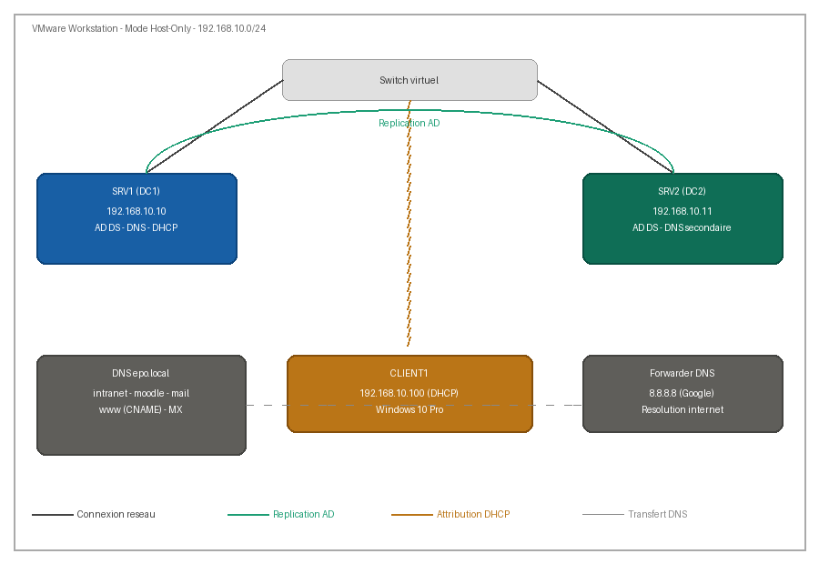

# Rapport technique — Infrastructure Windows Server 2022 (epo.local)

## Rapport

- [Rapport technique ](docs/rapport-technique.pdf)

## 1. Architecture

| Machine | Rôle | IP | OS |
|---|---|---|---|
| SRV1 (DC1) | DC principal, DNS primaire, DHCP | 192.168.10.10 | Windows Server 2022 |
| SRV2 (DC2) | DC secondaire, DNS secondaire | 192.168.10.11 | Windows Server 2022 |
| CLIENT1 | Poste client joint au domaine | DHCP (192.168.10.100) | Windows 10 Pro |

Réseau VMware : **Host-Only**, 192.168.10.0/24.

## 2. Checklist pré-installation (leçon apprise)

Ordre correct avant d'installer AD DS :

1. Mettre toutes les VMs sur le même réseau VMware (Host-Only)
2. Renommer le serveur (`Rename-Computer -NewName "SRV1" -Restart`)
3. Configurer l'IP fixe et le DNS
4. Vérifier avec `ping` et `ipconfig /all`
5. Installer AD DS + DNS
6. Promouvoir le domaine

> Incident rencontré : `Install-ADDSForest` échouait avec « Le protocole TCP/IP doit être correctement configuré ». Cause : VM en mode réseau inadapté (le ping vers sa propre IP échouait). Résolu en passant les VMs en **Host-Only**.

## 3. DNS

| Élément | Valeur |
|---|---|
| Zone directe | epo.local |
| Zone inverse | 10.168.192.in-addr.arpa |
| Mises à jour dynamiques | Secure |
| Forwarder | 8.8.8.8 |

| Nom | Type | Valeur |
|---|---|---|
| intranet | A | 192.168.10.20 |
| moodle | A | 192.168.10.30 |
| mail | A | 192.168.10.40 |
| www | CNAME | intranet.epo.local |
| @ | MX (10) | mail.epo.local |

## 4. Second contrôleur de domaine

Sur SRV2 : rôle AD DS, jonction au domaine (identifiants au format `EPO\Administrateur`), promotion en DC. Réplication vérifiée avec `repadmin /replsummary` : **0 échec sur 5**.

## 5. DHCP

Étendue **EPO-SCOPE** : 192.168.10.100–200, masque 255.255.255.0, passerelle 192.168.10.1, DNS 192.168.10.10 et 192.168.10.11, domaine epo.local.

## 6. Organisation Active Directory

OUs : Admin, Enseignants, Etudiants, Serveurs. Utilisateurs : admin1, prof1, etu1.

## 7. GPO

| GPO | Cible | Effet |
|---|---|---|
| Politique de mot de passe | Domaine | ≥ 8 caractères, complexité, expiration 30 j |
| Bloquer-PanneauConfig | Etudiants | Accès au panneau de configuration interdit |
| FondEcran-Enseignants | Enseignants | Fond d'écran imposé |
| Bloquer-USB | Etudiants | Stockage amovible désactivé |
| Parametres-Reseau | Etudiants + Enseignants | Client DHCP automatique |

> Remarque : `gpresult /r` n'affiche que les GPO **utilisateur**. Pour les GPO de **configuration ordinateur** (Bloquer-USB, Parametres-Reseau) : `gpresult /r /scope computer`.

## 8. Haute disponibilité

SRV1 éteint : `nslookup moodle.epo.local 192.168.10.11` répond via SRV2 → la résolution continue de fonctionner. Les clients reçoivent les deux serveurs DNS par DHCP et basculent après le délai d'expiration du premier.

## 9. Sécurité

- Transfert de zone DNS restreint à SRV2
- Verrouillage du compte après 5 échecs (30 min)
- Compte Invité désactivé

## 10. Questions théoriques

1. **Rôle du DHCP** : attribuer automatiquement IP, masque, passerelle et DNS aux clients.
2. **DHCP et DNS** : le DHCP communique aux clients l'adresse des serveurs DNS qu'ils utiliseront pour la résolution de noms.
3. **Pourquoi AD + DNS** : AD localise les contrôleurs de domaine via des enregistrements SRV du DNS ; sans DNS, ni jonction au domaine ni authentification.
4. **Rôle des GPO** : appliquer des configurations et restrictions de manière centralisée.
5. **Avantage de l'IP dynamique** : administration simplifiée, pas de conflits d'adresses, intégration rapide de nouveaux postes.

## 11. Bonus

IIS installé sur SRV1, site accessible via `http://intranet.epo.local`.

> Note : dans cette configuration, l'enregistrement DNS `intranet` pointe vers 192.168.10.20. Pour que le site IIS hébergé sur SRV1 soit joignable, soit l'enregistrement doit pointer vers 192.168.10.10, soit IIS doit être installé sur la machine ayant l'IP 192.168.10.20.
